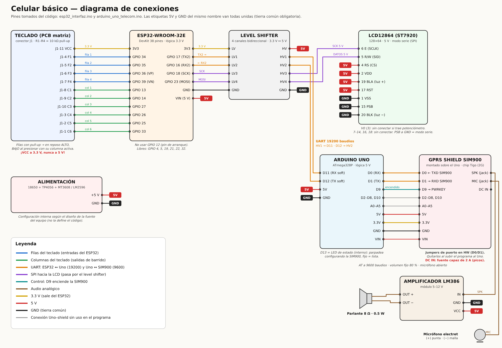

# Celular básico — ESP32 + Arduino Uno + GPRS Shield SIM900

Programa completo de un celular básico que **llama, recibe llamadas, envía SMS y recibe SMS**, dividido en dos placas:

| Placa | Programa | Qué hace |
|---|---|---|
| **ESP32-WROOM-32E** | `firmware/esp32_interfaz/` | Lee el teclado, maneja todos los menús, dibuja la LCD, mide la duración de la llamada y guarda los SMS recibidos (24 h). |
| **Arduino Uno + GPRS Shield SIM900** | `firmware/arduino_uno_telecom/` | Mediador de telecomunicaciones: recibe órdenes del ESP32 por UART y las convierte en comandos AT; avisa al ESP32 de llamadas, SMS y nivel de señal. |

Ambos programas son **no bloqueantes** (no usan `delay()`), están divididos en bloques comentados y tienen un comentario en cada línea.

```
 Teclado 4x6 ──► ESP32 ──SPI──► [level shifter] ──► LCD12864 (ST7920, 5 V)
                   │
                 UART2 (19200)
                   │
             [level shifter]
                   │
            Arduino Uno (D11/D12, SoftwareSerial)
                   │
             UART D0/D1 (9600)
                   │
            SIM900 (GPRS Shield) ──► SPK ──► LM386 ──► parlante 8 Ω
                                 ◄── MIC ◄── micrófono electret
```

## Estructura del repositorio

```
firmware/
  esp32_interfaz/
    esp32_interfaz.ino    programa del ESP32
    graficos.h            mapas de bits (GENERADO desde las PNG del diseño)
    tipos.h               enums y structs (menús, estados, SMS, órdenes)
  arduino_uno_telecom/
    arduino_uno_telecom.ino  programa del Arduino Uno
herramientas/
  generar_graficos.py     convierte las capturas del diseño en graficos.h
  pantallas_png/          las 31 pantallas del documento "INTERFAZ-TELEFONO"
pruebas/
  sim_esp32/              simulador en PC del ESP32 (teclado + LCD ST7920 virtual)
  sim_uno/                simulador en PC del Arduino (SIM900 falsa)
docs/
  pantallas_simuladas.png capturas de todos los menús generadas por el simulador
```

---

## 1. Conexiones



Diagrama completo (también en SVG: [`docs/diagrama_conexiones.svg`](docs/diagrama_conexiones.svg); se regenera con `python3 herramientas/generar_diagrama.py`).

### Teclado (conector J1 de la PCB) → ESP32

Las **filas** son entradas y ya tienen pull-up de 10 kΩ en la PCB (R1–R4), así que **en reposo leen ALTO** y leen BAJO cuando se presiona una tecla de la columna activa. Las **columnas** son salidas de barrido: solo una a la vez en BAJO y las demás en alta impedancia (nunca en ALTO, así dos teclas a la vez no hacen corto).

| J1 | Señal | ESP32 | Nota |
|---|---|---|---|
| 11 | VCC | **3V3** | ¡Nunca 5 V! las filas van directo al ESP32 |
| 4 | F1 | GPIO 34 | entrada (solo-entrada, sin pull-up interno: no hace falta) |
| 5 | F2 | GPIO 35 | entrada |
| 6 | F3 | GPIO 36 (VP) | entrada |
| 7 | F4 | GPIO 39 (VN) | entrada |
| 8 | C1 | GPIO 13 | salida |
| 9 | C2 | GPIO 14 | salida |
| 10 | C3 | GPIO 27 | salida |
| 3 | C4 | GPIO 26 | salida |
| 2 | C5 | GPIO 25 | salida |
| 1 | C6 | GPIO 33 | salida |

### LCD12864 (ST7920) en modo serie

| Pin LCD | Nombre | Conexión |
|---|---|---|
| 1 | VSS | GND |
| 2 | VDD | 5 V |
| 3 | V0 | sin conectar si el módulo trae potenciómetro de contraste |
| 4 | RS (CS) | **5 V fijo** |
| 5 | R/W (SID, datos) | HV4 del level shifter ← LV4 ← **GPIO 23** |
| 6 | E (SCLK, reloj) | HV3 del level shifter ← LV3 ← **GPIO 18** |
| 15 | PSB | **GND** (modo serie, obligatorio) |
| 17 | RST | 5 V (o sin conectar) |
| 19 | BLA | 5 V (luz de fondo) |
| 20 | BLK | GND |

Pines 7–14, 16 y 18 sin conectar.

### Level shifter de 4 canales (los 4 se usan)

| Lado 3.3 V (LV) | Lado 5 V (HV) |
|---|---|
| LV → 3V3 del ESP32 | HV → 5 V |
| GND → GND | GND → GND |
| LV1 ← GPIO 17 (TX2 del ESP32) | HV1 → **D11** del Arduino (RX) |
| LV2 → GPIO 16 (RX2 del ESP32) | HV2 ← **D12** del Arduino (TX) |
| LV3 ← GPIO 18 (SCK) | HV3 → pin 6 (E) de la LCD |
| LV4 ← GPIO 23 (MOSI) | HV4 → pin 5 (R/W) de la LCD |

### Arduino Uno ↔ GPRS Shield SIM900

| Arduino | Uso |
|---|---|
| D0 / D1 | UART por hardware con la SIM900 (9600). Poner los **2 jumpers de puerto del shield en la posición de hardware (D0/D1)**. |
| D9 | Encendido por software (PWRKEY). Si el shield no lo tiene habilitado, encender con su botón PWRKEY. |
| D11 / D12 | UART por software con el ESP32 (ver level shifter). |
| D13 | LED de estado: parpadea mientras se configura la SIM900; fijo = lista. |

**Audio:** salida SPK de la SIM900 → entrada de la placa LM386 → parlante de 8 Ω. Micrófono electret → entrada MIC de la SIM900 (canal principal). El volumen queda fijo en 80 % (`AT+CLVL=80`) y el micrófono siempre abierto (`AT+CMUT=0`).

**Tierra común:** GND del ESP32, Arduino, LCD, shield y fuente deben estar unidos.

**Pines libres del ESP32** para futuras funciones: GPIO 4, 5, 19, 21, 22, 32.

---

## 2. Cómo cargar los programas

### ESP32
1. Arduino IDE → Gestor de placas → instalar **esp32 (Espressif Systems)**.
2. Gestor de librerías → instalar **U8g2** (de olikraus).
3. Abrir `firmware/esp32_interfaz/esp32_interfaz.ino` (los archivos `graficos.h` y `tipos.h` deben estar en la misma carpeta).
4. Placa: **ESP32 Dev Module**. Subir.
5. Con `DEPURAR 1`, el Monitor Serie (115200) muestra teclas y mensajes con el Arduino.

### Arduino Uno
1. Abrir `firmware/arduino_uno_telecom/arduino_uno_telecom.ino`. Placa: **Arduino Uno**.
2. **Antes de subir: quitar los jumpers de puerto del shield (o apagarlo)**, porque la SIM900 usa D0/D1, los mismos pines del USB. Volver a ponerlos después.
3. No usar `Serial.print()` en este programa: todo lo que se imprime le llega a la SIM900.

### Antes de probar
- La **SIM900 es solo 2G (GSM)**. Verificar que el chip Tigo tenga cobertura 2G en la zona. Si la SIM no se registra en la red, el celular muestra **0 barras** (el Arduino consulta `AT+CREG?`).
- Quitar el **PIN** del chip (desde otro celular) o la SIM900 no podrá usarlo.
- La SIM900 tiene picos de consumo de hasta **2 A**: alimentar el shield con una fuente capaz (su entrada DC o 5 V/2 A); el USB del Arduino no alcanza.

---

## 3. Uso del teclado

| Tecla | Función |
|---|---|
| ← (atrás) | Marca el botón X / regresar del menú; si ya estaba marcado, lo ejecuta. |
| ⌫ (borrar) | Borra el último carácter. En "Leer mensaje": 1.ª vez nada, 2.ª vez elimina el mensaje. |
| Verde | Llamar (con número escrito) / contestar llamada entrante. |
| Rojo | Colgar / rechazar llamada. |
| ▲ | Sube; si no se puede, va a la derecha. |
| OK | Selecciona / confirma la letra que se está escribiendo. |
| ▼ | Baja; si no se puede, va a la izquierda. |
| ⇧ | Bloq mayús (solo en mensajes; se ve "MAY" abajo del cuadro). |
| #+- | `#`, `+`, `-` por pulsaciones (en cualquier cuadro). |

**Multi-toque** (solo al escribir mensajes): 1 pulsación = número; 2, 3, 4… = letras. La letra se confirma con OK o sola a los **0.9 s** (el tiempo se reinicia con cada pulsación).

| Tecla | 1 | 2 | 3 | 4 | 5 | 6 | 7 | 8 | 9 | 0 | # |
|---|---|---|---|---|---|---|---|---|---|---|---|
| Ciclo | 1abc | 2def | 3ghi | 4jkl | 5mnño | 6pqr | 7stu | 8vwx | 9yz | 0 ␣ | # + - |

Al marcar números las teclas 0–9 escriben el dígito directo.

**Números:** 8 dígitos sin `+` = número de El Salvador; se ve como `7777 7777` y se envía como `+50377777777`. Para otro país escribir primero `+` (dos pulsaciones de `#+-`) y el número se marca tal cual.

### Menús (resumen)
- **Menú principal:** ▲/▼ recorren teléfono → carta → bandeja (circular); el icono marcado se invierte. OK entra.
- **Llamadas:** se escribe el número (si no cabe se ven los últimos dígitos). ▲ marca la X, ▼ vuelve al cuadro sin borrar el número; OK en la X sale y borra. Verde llama.
- **Llamando / En curso:** el tiempo queda en 00:00 hasta que contestan; luego corre `mm:ss` hasta 99:59 y después muestra `99:59+`. ▼ marca COLGAR, ▲ lo desmarca, OK cuelga; el botón rojo cuelga de inmediato.
- **Llamada entrante:** aparece desde cualquier menú; muestra el inicio del número. ▲ = cheque, ▼ = X y luego alternan; OK ejecuta. Verde/rojo contestan/rechazan directo. Al terminar se vuelve al menú donde se estaba (lo escrito no se pierde).
- **Mandar mensaje:** número destino; ▲ = flecha de seguir, ▼ = flecha de regresar; desde las flechas ▲ vuelve al cuadro. OK en el cuadro lleva a la flecha de seguir.
- **Mensajes:** "ENVIANDO A:" con los primeros dígitos; el texto salta de línea solo visualmente y la primera línea desaparece cuando se llena el cuadro (al borrar reaparece). ▲ = enviar, ▼ = X. **OK nunca envía** (solo confirma letras).
- **Bandeja:** "1" es el más reciente. ▼/▲ recorren los mensajes; después del último (o antes del primero) se marca la flecha de regresar, y desde ella se vuelve al extremo de donde se vino. Con más de 2 mensajes aparecen flechas: negras si se puede subir/bajar, blancas si no.
- **Leer mensaje:** número del mensaje en el círculo y remitente arriba; mantener ▼/▲ desplaza el texto; al final aparece la fecha y hora de recepción. Un clic en ▼ marca la flecha de regresar.
- Los SMS se borran solos a las **24 h** de recibidos.

Capturas de todos los menús (generadas con el simulador): [`docs/pantallas_simuladas.png`](docs/pantallas_simuladas.png).

---

## 4. Protocolo UART ESP32 ↔ Arduino

Cada línea termina en `\n` y lleva checksum: `<contenido>*HH` (HH = XOR de los bytes, en hexadecimal). Las líneas dañadas se descartan.

| ESP32 → Arduino (`<id>,…`) | Acción en la SIM900 |
|---|---|
| `LLAMAR,<número>` | `ATD<número>;` |
| `COLGAR` | `ATH` |
| `CONTESTAR` / `RECHAZAR` | `ATA` / `ATH` |
| `SMS,<número>,<texto>` | `AT+CMGS` |
| `ESTADO` | reenvía señal y estado de la llamada |

El Arduino responde `ACK,<id>`; si no llega en 400 ms el ESP32 reintenta (hasta 6 veces). Si llega una orden repetida (mismo id) no se ejecuta dos veces.

| Arduino → ESP32 | Significado |
|---|---|
| `LISTO` | SIM900 configurada |
| `SENAL,<0-5>` | nivel de señal (solo cuando cambia; 0 = sin señal o sin red) |
| `LLAMANDO` | se está marcando |
| `EN_CURSO` | la llamada se conectó → el ESP32 arranca el cronómetro en 00:00 |
| `FIN` | la llamada terminó (colgamos, colgó el otro o se cortó) |
| `ENTRANTE,<número>` | llamada entrante |
| `SMS,<número>,<aa/mm/dd hh:mm:ss>,<texto>` | SMS recibido |
| `SMS_OK` / `SMS_ERROR` | resultado del envío |

Los textos viajan en Latin-1 (para la ñ y las tildes); el Arduino los convierte al alfabeto GSM al enviar, y convierte los SMS recibidos en GSM o UCS2 (los que mandan los smartphones con tildes).

---

## 5. Revisión del trabajo previo

| Archivo | Qué se conservó | Problemas encontrados y cómo se resolvieron |
|---|---|---|
| `Telecomunicaciones.ino` | La base (máquina de estados AT no bloqueante, lectura de SMS, CLCC, CSQ). | Enviaba el tiempo de llamada (ahora lo mide el ESP32). No tenía enlace real con el ESP32 (`tlfEnlaceESP = NULL`) → se agregó UART con checksum, ACK y cola de salida. Se agregó: ñ/tildes (GSM y UCS2), recuperación de SMS que llegaron con el módulo apagado, aviso `MO CONNECTED`, reinicio si la SIM900 se apaga, encendido por D9, registro en red (`AT+CREG?`), SMS borrado de la SIM solo después de entregarlo. |
| `sketch_oct15aSP32.ino` | El mapa de la matriz (coincide con la PCB) y la idea de barrer columnas. | **GPIO 12 es pin de arranque** (con una tecla presionada al encender, el ESP32 no arranca) y **GPIO 23 se necesita para la LCD** → pines cambiados. No tenía antirrebote real → ahora 4 lecturas estables (20 ms). `readStringUntil` bloquea hasta 1 s → lectura byte a byte. |
| `sketch_oct15aUNO.ino` | Pines 11/12 para el ESP32. | `Serial.begin(115200)` + `Serial.println` usan D0/D1, **los mismos pines de la SIM900** (le mandaba texto basura). `readStringUntil` bloqueante. El comentario decía pines 2/3. |
| `interfaz_telefono_esp32.ino` | Ideas generales (capas estática/dinámica, redibujar solo si cambia). | Estaba hecho para una **OLED SSD1306 I2C**, pero la pantalla comprada es una **LCD12864 ST7920 de 5 V (SPI)**; no usaba los mapas de bits del diseño. Se reescribió completo. |
| `Interfaz-Telefono-Bits.txt` | — | Formato SSD1306 (páginas verticales), **bits invertidos**, nombres repetidos y faltaban pantallas (mensajes, subir, leer…). Se generaron los gráficos desde las PNG del documento, que estaban completas. |

### Diferencias con el diseño gráfico
- La señal del diseño tenía 4 barras; se dibujan **5** (niveles 1–5) con puntos para las barras apagadas.
- Bandeja y "Leer mensaje": el diseño solo tenía ejemplos con 1 y 2; ahora el número del círculo, las casillas y las flechas cambian según los mensajes.
- Agregados pequeños (fáciles de quitar en el código): contador `n/160` y "MAY" bajo el cuadro del mensaje, "COLGANDO…"/"FINALIZADA" en la llamada, "SIN MENSAJES" con la bandeja vacía, avisos "ENVIANDO…/MENSAJE ENVIADO/ERROR AL ENVIAR".

### Limitaciones conocidas
- Los SMS se guardan en la RAM del ESP32: si se apaga el celular se pierden (las 24 h se cuentan desde que llegaron, con el ESP32 encendido).
- Un SMS largo de varias partes llega como mensajes separados.
- Al enviar se admiten letras, números, espacio, `# + -` y la ñ (alfabeto GSM, máximo 160 caracteres).

---

## 6. Pruebas sin hardware

El código se verificó así:
- **Compilación real:** Arduino Uno con `avr-gcc` (11 KB de flash = 33 %, 1451 B de RAM = 70 %) y ESP32 con el toolchain de Espressif, core 2.0.17 (302 KB de flash, 33 KB de RAM).
- **Simulador del ESP32** (`pruebas/sim_esp32`): compila el `.ino` real con la librería U8g2 real, emula el teclado a nivel de pines y **decodifica los bytes SPI que recibiría la ST7920** para reconstruir su memoria; comprueba en cada captura que la LCD quede idéntica a lo dibujado (verifica el envío parcial de zonas).
- **Simulador del Arduino** (`pruebas/sim_uno`): conecta el `.ino` real a una SIM900 falsa (llamadas, SMS GSM/UCS2, señal, apagado del módulo) y a un ESP32 falso.

```sh
cd pruebas/sim_esp32 && ./compilar.sh <ruta a U8g2_Arduino/src> && ./build/sim casos.txt
cd pruebas/sim_uno   && python3 generar_casos.py && ./compilar.sh && ./build/sim casos.txt
```

Para volver a generar los gráficos después de editar las PNG: `python3 herramientas/generar_graficos.py` (requiere Pillow).

## 7. Parámetros ajustables

| Dónde | Parámetro | Valor |
|---|---|---|
| ESP32 | `MULTITAP_MS` | 900 ms para confirmar una letra |
| ESP32 | `LCD_RELOJ_HZ` | 600 kHz (bajar si la LCD muestra basura) |
| ESP32 | `LCD_ACTUALIZACION_PARCIAL` | 1 = reenvía solo lo que cambió |
| ESP32 | `BANDEJA_MAX` / `VIDA_SMS_MS` | 30 mensajes / 24 h |
| Arduino | `TLF_VOLUMEN_BOCINA` | 80 |
| Arduino | `TLF_GANANCIA_MIC` | 10 (0–15) |
| Arduino | `USAR_PIN_ENCENDIDO` | 1 = pulsa D9 si la SIM900 no responde |
| Ambos | `UART_BAUDIOS` / `BAUD_ESP` | 19200 (deben ser iguales) |
